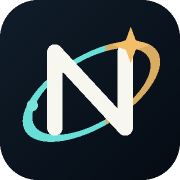

<div align="center">
  
  <h1>星轨 · Orbit</h1>
  <p><strong>让自选、行情与星际伙伴，在同一个世界相遇。</strong></p>
  <p>移动端看盘应用 · 星际伙伴 · 卡牌行情 · 黑金钱包 · 策略回测</p>
  <p>
    <a href="#功能一览">功能一览</a> ·
    <a href="#快速开始">快速开始</a> ·
    <a href="docs/服务器发布与安卓客户端.md">部署与 Android</a> ·
    <a href="docs/admin-setup.md">后台管理</a>
  </p>
  <a href="https://github.com/Gh811/orbit-market-lab/actions/workflows/check.yml"></a>
</div>

<br>

Orbit 把自选分组变成星际伙伴，把行情变成可以翻动的卡牌。在手机上查看市场、整理持仓、阅读新闻，并用历史数据检验预设策略。

支持 **OKX USDT 永续合约**与**沪、深、北交易所 A 股**。项目包含移动端网页、Android WebView 客户端、Python 服务和独立权限的管理后台。

## 功能一览

| 功能 | 体验 |
| --- | --- |
| **星际伙伴** | 用伙伴管理自选分组，查看图鉴、切换形象，体验不同伙伴的随机动作。 |
| **卡牌行情** | 左右滑动浏览标的，查看报价、迷你 K 线和方向参考；点击 Logo 打开资料。 |
| **搜索与新闻** | 支持代码、中文名称、别名和近似匹配；按标的阅读纸页风格的新闻。 |
| **黑金钱包** | 搜索标的、录入持仓，查看成本与估值；支持按币种展示及金额隐藏。 |
| **策略回测** | 选择 BTC、ETH 预设策略，查看收益、年化、回撤与资金曲线，基础参数只读展示。 |
| **后台管理** | 独立管理员登录，查看用户与在线状态，执行封禁、解封和下线操作。 |

### 认识你的星际伙伴

<div align="center">
  
  
  
  <p><sub>项目内伙伴插画。完整形象与互动以应用中的图鉴为准。</sub></p>
</div>

## 快速开始

**运行环境：**Python 3.11+、系统 `curl`。验证与回测另需 Node.js 22、Bash 和 Git；主服务使用 Python 标准库，无需额外安装 Python 依赖。

```bash
# 获取项目
git clone git@github.com:Gh811/orbit-market-lab.git
cd orbit-market-lab

# 启动开发服务
python3 server.py
```

默认地址为 `http://127.0.0.1:8000/`。桌面与普通 Android 浏览器进入下载页，iOS 浏览器和 Android 客户端进入应用。手机访问需配置可访问的域名及反向代理，详见 [部署与 Android 客户端](docs/服务器发布与安卓客户端.md)。

使用其他端口：

```bash
MARKET_PORT=8001 python3 server.py
```

首次启动时可提供可选的 Finnhub API Key。没有 Key 仍可使用公开行情、标的搜索及 A 股资料，部分新闻和公司资料来源可能受限。

## 数据与缓存

- **资料预先入库**：公开目录、已获取的简介、官网和 Logo 存入服务器 SQLite 数据库，后续访问优先读取本地资料。
- **手机复用缓存**：已获取的资料和图片保存在客户端，自选项受保留保护；长期不用的非自选缓存逐步清理。
- **行情独立更新**：报价与 K 线按各自周期刷新，上游暂不可用时明确标记缓存状态。
- **标的身份独立**：A 股与股票关联合约按市场、代码分别处理，保留各自的计价币种。
- **资料可迁移**：公开资料库可独立导出、导入；目录收录不等于所有资料已完整获取。

缓存按浏览器和访问域名隔离，正式使用建议保持稳定域名。预采集、补采、完整性审核和迁移命令见 [运行与数据维护](docs/operations.md)。

## 配置

| 环境变量 | 默认值 | 用途 |
| --- | --- | --- |
| `MARKET_PORT` | `8000` | 本地服务端口 |
| `MARKET_ACCOUNT_DB` | `.market_accounts.sqlite3` | 账户、自选与持仓数据库 |
| `MARKET_DATA_DB` | `.market_data.sqlite3` | 公开行情、标的资料与图标缓存 |
| `MARKET_PUBLIC_HOST` | 未设置 | 允许访问的公开主机名 |
| `FINNHUB_API_KEY` | 未设置 | 可选新闻与公司资料来源 |
| `MARKET_ADMIN_CONFIG` | 账户数据库旁的 `admin-credentials.json` | 私有管理员凭据文件 |
| `MARKET_IP_REGION_DIR` | 账户数据库旁的 `ip-region/` | 可选离线地区库 |

管理员入口为 **`/admin`**，与主应用属于同一项目，使用独立的管理员会话。凭据创建、地区库配置及权限说明见 [后台部署说明](docs/admin-setup.md)。

## 检查与发布

本项目使用 `main` 分支。日常发布通过 Bash 脚本完成：

```bash
# 移动端与核心功能检查
bash scripts/check-mobile.sh

# 完整服务端回归检查
python3 -m unittest discover -s tests -p 'test_*.py'

# 检查、提交并推送到当前分支
bash scripts/publish-update.sh "说明本次修复和改动"
```

发布脚本先运行移动端检查，再暂存未被忽略的项目文件、创建提交并推送到 `origin` 当前分支；没有新改动时直接推送。发布前请确认当前分支为 `main`，并同步修改受影响的文档。

生产部署采用固定代码快照，资源引用按内容生成版本号，减少新旧资源混用。构建、切换和状态核对见 [运行与数据维护](docs/operations.md#固定版本发布)。

账户和行情数据库、管理员凭据、环境文件、SSH 与签名密钥、日志及本地构建产物不属于源码发布内容。迁移这些运行资料时需单独备份，避免将运行中的 SQLite 主文件直接作为完整备份。

## 项目结构

```text
orbit-market-lab/
├── server.py          服务入口、行情与任务接口
├── accounts.py        账户、自选与持仓持久化
├── admin_portal.py    管理员权限和管理接口
├── admin.html         后台管理页面
├── assets/            移动端界面、伙伴与公开素材
├── android/           Android 客户端与构建脚本
├── backtest/          策略、回测引擎与结果界面
├── data/              公开标的目录
├── tools/             第三方辅助工具与许可证
├── scripts/           验证、采集、迁移与发布工具
├── tests/             自动化测试
└── docs/              部署、维护与素材说明
```

## 更多文档

| 文档 | 内容 |
| --- | --- |
| [部署与 Android 客户端](docs/服务器发布与安卓客户端.md) | 服务部署、客户端构建与更新 |
| [后台部署](docs/admin-setup.md) | 管理员配置、权限与地区库 |
| [运行与数据维护](docs/operations.md) | 资料采集、迁移及固定版本发布 |
| [数据库维护](docs/database-maintenance.md) | 数据位置、备份与恢复 |
| [资料完整性](docs/data-integrity.md) | 目录、简介、官网与图标的审核口径 |
| [移动端界面目录](docs/界面目录.md) | 功能入口与返回关系 |
| [策略与回测](backtest/README.md) | 执行规则、结果口径和验证范围 |
| [素材与署名](docs/artwork-credits.md) | 插画、图标与第三方素材来源 |

> 卡牌方向参考与回测结果基于历史数据，不代表未来表现。当前策略功能用于分析和模拟，不会自动向交易所提交订单。
